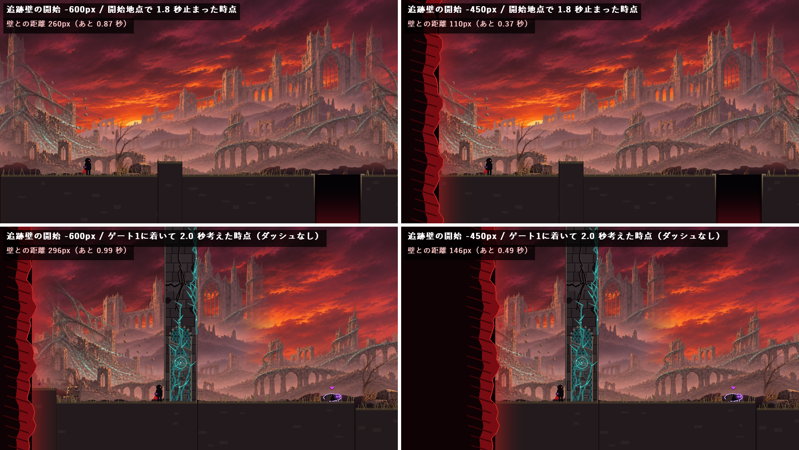
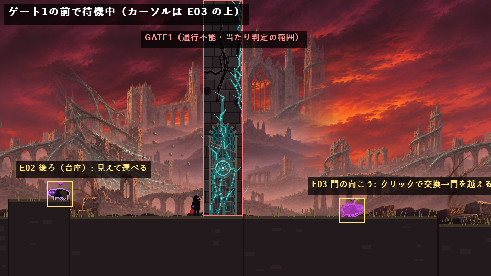
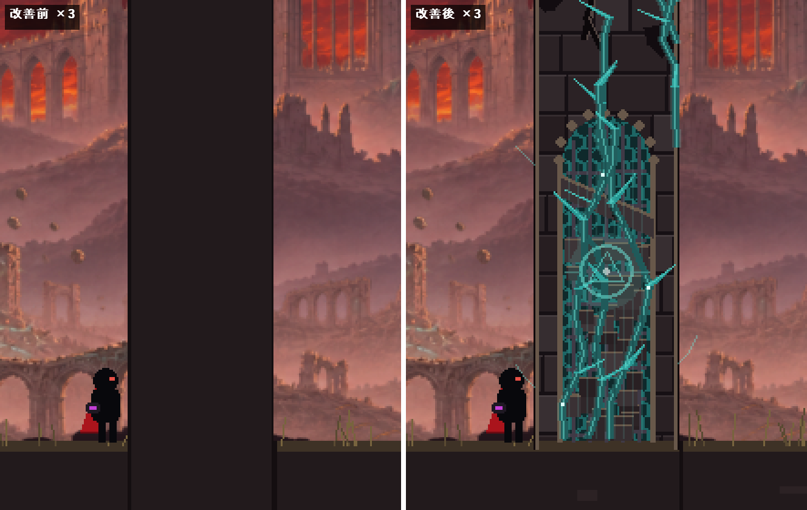
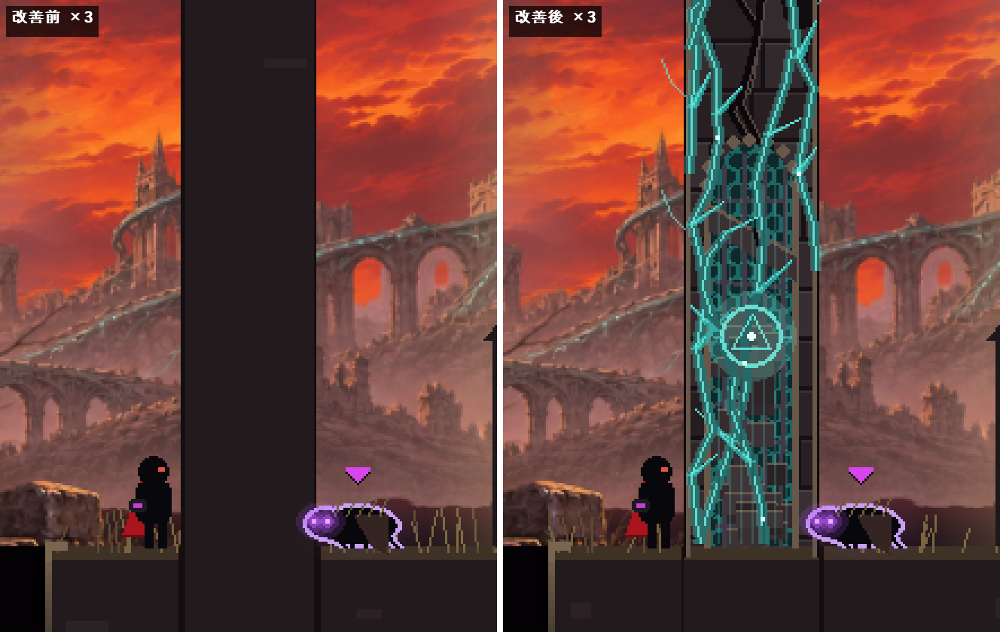

# 終焉を背に（仮） - プロトタイプ v2.0

## v2.5 ステージ1 C案: 後半はテレポート必須（Claude, 2026-11-17）

> 追加検証（壁 −600/−450 の再比較、ゲート1の E02・E03 の照合、近景装飾の調査と配置の修正候補、
> ゲート1での再挑戦時間とチェックポイント案、テスト・物理トレースの整合性、未検証事項）は
> `stages/qa_stage1_v25/REPORT_followup.md` にあります。
>
> **承認後に反映（2026-11-17）:**
> - **近景装飾:** 配置の x を3か所変更しました（`grass` 1400→1600、`grass` 2620→2360、`ruin_left` 3050→2700）。素材は変更していません。
> - **チェックポイント（案A）:** `stage_1.json` の `checkpoint` に設定しています（x=1,560、追跡壁は 800px 後ろから）。
>   - 有効になる条件: そのプレイで x=1,560 を越えてから死ぬこと。初回は必ず最初から走ります。
>   - 有効後の死亡画面: 「チェックポイントから／最初から／タイトルへ戻る」。
>   - 再開時: 敵・タイマー・テレポートは最初の状態に戻り、HUD に「チェックポイントから再開」が2秒表示されます。
>   - 時間の表示: 生存時間・クリア時間はチェックポイントからの時間で、「（チェックポイントから）」と表示します。
>   - 解除される場面: タイトルへ戻る、「最初から」、クリア後の「もう一度プレイ」。
>   - テスト: `tests/test_checkpoint.py`（29件）。
> - **最終QA・目印（同日）:** チェックポイントの位置 x=1,560 に、壊れた石碑＋異星の装置の目印を描くようにしました（描画のみ、当たり判定なし）。
>   - 未起動: 暗い青紫。チェックポイントを越えると光の柱とともに起動し、以後は淡い青紫に光ります。
>   - 境界条件・再開時の整合性・目印の検証は `stages/qa_stage1_v25/REPORT_final_qa.md` にあります。
> - **ステージ1ボス戦の詳細設計（未実装・承認待ち）:** `stages/boss1_design/BOSS1_SPEC.md` にあります。
>   - 既存コードでの試作の結果は `stages/boss1_design/prototype_check.txt`、配置図は `arena_layout.png` です。

ゲーム物理・テレポートの仕様・追跡壁の速度・正式背景素材は変更していません。
変更はステージJSON（地形・敵・出現位置・追跡壁の開始位置・`world_width`）と、城門の描画（`stages/renderer.py` の `SealedGateArt`）だけです。
地形の `style`（`"ground"` / `"sealed_gate"`）は描画専用で、当たり判定は JSON の矩形のままです（`stages/loader.py`）。

構成は下の「ステージ1の構成」、検証の詳細・比較画像・再実行用スクリプトは `stages/qa_stage1_v25/` にあります
（`game` で `python stages/qa_stage1_v25/shots.py`、`python stages/qa_stage1_v25/wall_compare.py .`、`python stages/qa_stage1_v25/fuzz_check.py .`）。
テストは Python 3.15.2 / pygame-ce 2.5.8 / SDL dummy で全231件成功（チェックポイントの目印と最終QAの後）。

### 1. 追跡壁の開始位置: −600px を採用（−450px と比較）

主人公の出現は x=200 なので、開始時の壁との距離は −600 で 800px、−450 で 650px。
どの指標でも −600 のほうが 150px（＝0.5秒）多く、その分がそのまま後半の余裕になります（`wall_compare_output.txt`）。

| 指標（ボット、ダッシュなし／あり） | −600 | −450 |
| --- | --- | --- |
| ゲート1到着時の壁との距離 | 889px（2.96秒）／1,081px（3.6秒） | 739px（2.46秒）／931px（3.1秒） |
| ゲート1で考えられる最長時間（ゲート2は即交換） | 2.9秒／3.55秒 | 2.4秒／3.05秒 |
| ゲート1で1秒考えた後、ゲート2で考えられる時間 | 2.6秒／3.2秒 | 2.1秒／2.7秒 |
| ゲート1で2秒考えた後、ゲート2で考えられる時間 | **1.8秒**／2.4秒 | **1.3秒**／1.9秒 |
| 開始地点でためらえる時間（ゲート1で1秒考える場合） | 1.6秒／2.2秒 | 1.1秒／1.7秒 |
| ゲート1で誤って後ろの E02 と交換した場合に、誤クリックまでに考えられる時間 | 0.85秒／1.25秒 | 0.35秒／1.0秒 |
| 同上で、考えずに誤クリックした場合の最小の壁との距離 | 286px／476px | 136px／326px |
| 必須交換だけでクリア（踏み切り±20px×100通り、各ゲートで1秒考える） | 100／100 | 100／100 |
| 開始地点で止まっていると壁が画面に現れるまで | 2.0秒 | 1.5秒 |

- 後半の難易度への影響: 最も厳しいのは「ゲート1で迷った後のゲート2」（ダッシュなしでゲート1で2秒迷うと、−450 ではゲート2の猶予が1.3秒）と、
  「ゲート1での誤クリック」（−450 では誤クリック前に0.35秒しか迷えない）。−600 はこの2点を初見向けの水準（1.8秒・0.85秒）に保つ。
- 熟練者の最短（最遠の敵を即使用、5.88秒）と、普通に必須交換だけを使う場合のクリア時間（8.97秒／8.33秒）は、開始位置によらず同じ。
  変わるのは「どれだけ迷えるか」だけです。
- 代償: 普通に走っている間は、どちらの設定でも壁は画面に映りません（どちらも同じ）。壁を見るのは、立ち止まったとき（左上の画像）か、
  ゲート前で考えているとき（左下の画像）です。HUD の「追跡壁まで」の表示が頼りになります。−450 にしても、この点はほとんど変わりません。



### 2. ゲート1の E02: 見える配置のまま（判定を確認、配置の調整は不要）

- ゲート1の前で待っている間（8秒・全フレーム）、門の向こうの E03 は画面内に完全に収まり、既存の `targeting.find_target` で選択でき、
  実際のクリックと同じ入力経路（`MOUSEBUTTONDOWN` → `InputState` → `World.update`）で交換が成立して門の向こうへ移る。
  待ち 0／2／6 秒、空中（上昇中・頂点・下降中、二段ジャンプ使用後）でも同じ。ゲート2の E04 も同じ。
- 城門は地形の描画の中で描かれ、敵は後から描くので、門の絵に敵や交換可能の印が隠れることはない（描画結果で確認）。門そのものをクリックしても何も選ばれない。
- 後ろの E02（台座の上）もゲート1の前から見え、選べる。E02 と E03 の選択範囲は重ならない。
- 誤って E02 と交換しても（約300px戻る・クールダウン消費）、クールダウン明けに E03 と交換すれば −600 ではクリアできる（上の表）。
- **見えているのに選べない、という状況はなかったので、敵と城門の配置は変えていません。** テレポートの仕様も変更なし。



### 3. 城門の見た目（描画のみ）

崩落した城門に異星の侵食が重なった絵にして、通れない障害物だと分かるようにしました。

- 崩落した城門: 石積み、全幅の断裂（ずれ落ちた石）、亀裂、下ろされて曲がった落とし格子、斜めに落ちた楣石、アーチの下を埋める瓦礫。
- 異星の侵食: 青緑に光る脈と結晶、アーチをふさぐ六角格子の膜、中央の封印の紋章。脈打つ光と、脈を昇る光の粒が動きます。
- 色: 侵食は背景の侵食都市の青緑に合わせました。テレポートの赤紫・追跡壁の赤とは色の系統が違います（テストで確認）。
- 当たり判定との対応: 不透明な石・結晶は当たり判定の矩形の内側だけに描きます。外にはみ出すのは細い光の筋だけ（片側12px）で、足場には見えません。
  テストで、結晶が矩形の外にはみ出していたのを見つけて直しました。
- 重い描画は初期化時に焼き込み、毎フレームは2枚の blit だけです。




### 後半でテレポートが必須であることの自動検証（`tests/test_stage1_layout.py`）

| 検証 | 内容 | 結果 |
| --- | --- | --- |
| 幾何 | 城門の上端（y=0）は、主人公が届く最高点（長押し＋二段ジャンプ＋空中ダッシュ）より 100px 以上上。下端（y=700）は落下死ライン＋主人公の身長より下。幅は 60px 以上。すり抜け足場はなし | 抜け道なし |
| ランダム入力 | 壁を止めて時間無制限。左右・ジャンプ・二段・ダッシュ・降下に、手前側の敵との交換も混ぜる。各門 120回×8秒（テスト内）、1,500回×8秒（`fuzz_check.py`） | どちらの門も、到達した最右点は門の左端ちょうど |
| テストの検出力 | 城門の上端を y=250 に下げた版と、下端を y=540 にした版では、ランダム入力が抜け道を見つける。上端を y=180 にした版は見つけられないが、幾何のテストが検出する | 2段構えで検出 |
| テレポートなしの自動操作 | ダッシュ有無 × 踏み切り位置のばらつき | すべてゲート1の前で止まり、壁に飲まれる |
| 敵 | 交換された敵以外は、城門をはさんで反対側へ移らない | 確認済み |
| 交換 | 城門を越える交換は、その門の向こうの敵との交換だけ | 確認済み |

自動操作 `tests/stage1_bot.py` に、地上ダッシュで降り段の縁から飛び出して着地しないまま穴の上に出たときに空中で跳ぶ動作を加えました（人間なら当然跳ぶ場面です）。
これがないと、ゲート1で 0.1 秒だけ考えたときなどにボットだけが落下し、「考えられる時間」を実際より短く測ってしまっていました。
物理トレース（`tests/fixtures/physics_trace_v22.json`）は、このボットの4通りのプレイ（テレポートなし／必須のみ／E02 空中交換＋必須／熟練）で再生成しました。

空中交換の後の詰み対策（`tests/test_stage1_recovery.py`）: E01〜E04 のどれと二段ジャンプ使用後に空中交換しても、
着地した地面から次の穴までの間に降り段か台座の縁があり、降りればジャンプが回復します。

### 未対応・判断が必要な点

- 城門で失敗すると、ステージの最初（ゲート1まで約6秒）からやり直しになる（チェックポイントは現在の仕様にない）。
- E01 を使うとクールダウンが重なり、区間3の空中交換の練習を逃すことがある。
- 近景の装飾（`L3_near_debris` の配置）は旧地形に合わせたまま。新しい地形と見た目がずれていないかは、実機で確認が必要。
- 実機（Windows）での見た目とプレイ感は未確認（画像はすべて SDL dummy ドライバでの描画）。

## v2.3 実機QA反映・表示改善（Claude, 2026-11-13）

ゲームルール・地形・敵配置・移動速度・追跡壁・テレポート仕様は変更していません。
v2.2（コミット `1ffc37e`）で記録した物理トレース（主人公・敵・追跡壁・**カメラX**・交換回数の毎ステップ値、
自動操作3通り）と完全一致することを `tests/test_v23.py` で検証しています（描画あり・なしの両方）。

### 表示モード（設定で切替）

| モード | 内容 |
| --- | --- |
| Pixel Perfect（既定） | 従来どおり整数倍のみ。2倍に満たないウィンドウでは等倍で中央に置き、余白は黒帯 |
| Fit to Window | ウィンドウに収まる最大倍率（非整数可）。16:9 を維持、補間は最近傍、余白は黒帯 |

- 切替: **F8**（どの画面でも）、ポーズメニューの「表示: …」、起動オプション `--display pixel_perfect|fit`。
  選んだモードは `game/settings.json`（git管理外）に保存され、次回起動時も使われる。
- 仕組み: `pygame.SCALED` の SDL レンダラーで `SDL_RenderSetIntegerScale` だけを切り替える（`systems/display.py`）。
  マウス座標は SDL が描画と同じビューポートで内部座標へ変換するため、照準・カメラの座標変換コードは変えていない。
  黒帯のクリックは 0〜960 / 0〜540 の範囲外の座標になり、対象選択で除外される。
  SDL レンダラーを取得できない環境では Pixel Perfect のまま動作する。
- 高DPI: 既定は従来どおり DPI 非対応（Windows 125%/150% では OS がビットマップ拡大してぼやける）。
  `--high-dpi` で SDL に Per-Monitor V2 を指定する（`--no-high-dpi` で戻す。設定は保存される）。
  Fit と併用すると初期ウィンドウを OS 倍率ぶん大きくし、見かけの大きさを従来と揃える。Windows の倍率は変更しない。
- `pygame.mouse.get_pos()` は 960×540 内に丸められる（黒帯上では端の値）。プレイ開始・ポーズ解除時の照準初期位置にのみ使い、
  クリックはイベント座標で判定するため誤交換は起きない（実機で確認）。

### フレーム時間の調査（作業B）

実ウィンドウで処理時間の内訳（テレポート判定・演出の生成/描画・背景・地形・敵・主人公・HUD・flip・待機）を計測した。

- テレポート自体: 判定 0.3〜0.5ms、演出生成 0.2ms、演出描画 約1ms。原因ではなかった。
- 原因: **日本語フォントの初回検索（約17ms）とサイズごとの初回生成（約1ms）**。
  QA時の「テレポートあり」の計測はタイトル画面を経ずに開始していたため、この初期化が最初のプレイフレーム
  （開始直後の1回目のテレポートと同じフレーム）に乗り、HUD描画 22.7ms・フレーム処理 28ms になっていた。
  通常起動でもタイトル初回フレーム 36〜38ms、プレイ初回フレームの HUD 5〜6ms が同じ原因。
- 対応: `ui/fonts.py` の `preload()` で UI が使う全サイズを起動時（最初の描画前）に生成する。描画結果は変わらない。

| 実ウィンドウ・125%・自動操作でクリア | 平均FPS | 99%フレーム | 最大フレーム | 20ms超 | 処理時間 平均 / 最大 |
| --- | --- | --- | --- | --- | --- |
| 修正前 テレポートあり（2回） | 60.1〜60.2 | 18ms | 28〜29ms | 各1 | 4.4〜4.5ms / 28ms |
| 修正前 テレポートなし（2回） | 60.1〜60.4 | 18ms | 18ms | 0 | 5.3ms / 37ms（タイトル初回） |
| **v2.3 テレポートあり（2回）** | 60.2〜60.5 | 18ms | **18ms** | **0** | 4.5〜4.6ms / 12〜14ms |
| **v2.3 テレポートなし（2回）** | 60.1〜60.4 | 18ms | 18ms | 0 | 5.5〜5.7ms / 20ms（タイトル初回） |
| v2.3 Fit・高DPI 1800×1000（2回） | 60.1〜60.5 | 18ms | 23〜24ms | 各1 | 3.9〜4.3ms / 24ms |

- v2.3 の値は視認性改善・テレポート演出の追加後。処理時間の平均は 0.1〜0.3ms 増えた。
- Fit の 23〜24ms は**ウィンドウのリサイズ直後の最初のフレーム**（flip 9.8ms＋初出文字のHUD描画 4.9ms）。
  リサイズ1回につき1フレーム程度の一時的なもので、同じプロセスの2回目のプレイでは発生しなかった。
- 処理時間が 6〜12ms でも 20ms 前後のフレームが散発することがある。`clock.tick` の待機（OSタイマー粒度）のぶれで、
  処理の遅れではない。未対策。

### 視認性（作業D、描画のみ）

当たり判定・位置・背景素材（`draft_v1`）は変更していない。強さは `config.VISIBILITY` で調整・無効化できる。

- 敵: 明るいラベンダーの縁取り（2px）と背後の淡い光。テレポートで交換できる敵（画面内・交換可能）の頭上に小さな印を表示し、
  使用可能時はテレポート色、クールダウン中は暗くする。ホバー時の輪郭発光は従来どおり。
- 穴: 内部を上は黒・底へ向かって赤く光る「奈落」にし、穴に面した地面の側面に明るい石の縁と角の石を描く。
  穴の位置は地形データ（画面下端まで届く地面の切れ目）から求める。

| 輝度コントラスト比（WCAG式、同じカメラ位置） | 改善前 | v2.3 |
| --- | --- | --- |
| 敵の輪郭 対 周囲（E01 / E02 / E03 / E04） | 1.46 / 1.93 / 1.12 / 1.67 | 2.84 / 2.26 / 3.83 / 2.51 |
| 穴に面した地面の縁 対 穴の内部 | 1.11〜1.23 | 2.20〜2.21 |
| 穴の内部 対 地面（輝度のみ） | 1.11〜1.19 | 1.17 |

- 暗い紫の縁取り（138,82,190）も試したが、中間調の空の前で 1.12 まで下がったため不採用。
- 穴と地面は輝度差ではなく色相（赤）と縁の明るさで区別している。輝度だけで見分けにくい点は残る。

### テレポート時の画面演出（作業E）

- 現状確認: 交換直後のカメラは1フレームで 167〜235px 動く（追従係数3倍の0.25秒間）。
- **カメラの動きは変更していない。** 追従の緩急を変える案（立ち上がりを 0.05〜0.1秒で緩める）を試したが、
  カメラの視野が敵の更新範囲・交換可能範囲に使われているため、自動操作3通り中2通りで物理トレースが変わった（結果は同じクリア）。
  ゲームプレイを変えない条件を優先し不採用。
- 追加した演出（`config.TELEPORT_FX`、見た目のみ）:
  - 流線: カメラの移動予定量が 60px 以上のとき、背景の手前・キャラクターの後ろに、背景が流れる向きの細い光の線を 約0.16秒。
  - ロケーター: 到着した主人公の周りで 70px→24px に縮むリングを 0.35秒（移動先へ視線を誘導）。
  - 既存の残像・2点を結ぶ光・衝撃波はそのまま。パララックス背景には触れていない。

### 自動テスト

```powershell
cd game
python -B -m unittest discover -s tests -v
```

Python 3.15.2 / pygame-ce 2.5.8 / SDL dummy で **174件成功**（既存152件＋`test_v23.py` 22件）。
`test_v23.py`: 物理トレース一致（描画あり/なし）、フォント先読み、表示モードの配置計算・黒帯・カメラ移動を含む対象選択、
設定ファイル・F8/ポーズメニューでの切替、SDLの整数倍設定の実切替、視認性（穴の検出・描画・敵の縁取り・印・無効化）、
テレポート演出（生成条件・消滅・無効化）。

### 実機確認（Windows 125% のみ）と未検証事項

実ウィンドウでの照準検証の結果は [tests/AIMING_CHECKLIST.md](tests/AIMING_CHECKLIST.md) に記録した
（4構成×6〜8サイズ、計219ケース成功）。

- **未検証**: Windows 100%・150%、モニター間移動、最大化・全画面、macOS/Linux での表示モードと高DPI。
- **未検証**: 視認性・テレポート演出の見え方の人による評価（今回の判断は数値と静止画による）。
  初見クリア率などの試遊目標も未測定。
- Fit＋高DPIの照準検証で、1回だけ検証中にOS側でウィンドウ幅が変わり（1536→1566）3ケース失敗した。再実行2回は全て成功。原因は未特定。


## v2.2 確定仕様と安定化（Codex）

照準検証の手順・チェックリスト・実施状況は
[tests/AIMING_CHECKLIST.md](tests/AIMING_CHECKLIST.md) を参照してください。
**内部座標の回帰テストを含む116件が成功。実画面でのサイズ・DPI・縦横比別の照準一致は未検証です。**

v2.0・v2.1の履歴と基準パラメータは下記に保持しています。

- ボスステージはボス撃破が必須です。生存中のゴール到達ではクリアしません。
  現在の基盤では把握した全ボスの攻撃による死亡処理完了後、クリア画面へ進みます。
  通常ステージは従来どおりゴール到達でクリアします。
- ボスの穴・追跡壁への交換による環境即死攻略は不可です。安全検査に加えて交換先の接地を必要とします。
  AIによる環境死亡は撃破・クリア・最終ボスによる壁永久停止の条件に含めません。
- 足元中央を基準に双方の安全位置を探索し、双方が確定してから交換します。
  体格差で配置できなければ失敗し、CD・行動権を消費しません。
- `test_single_well_timed_teleport_over_rampart` はB01をE03との正確に1回の交換で突破し、クリアすることを検証します。
  2回ルートは `test_two_teleports_can_escape` に分離しています。
- 内部解像度は960×540固定で、異なる解像度のステージJSONは拒否します。
  拡大とマウス座標変換には `pygame.SCALED` を使用し、SDLに最近傍補間を指定しています。
  クリックイベントの `pos` とカメラオフセットを使って対象を選択します。実画面での正しさは別途確認が必要です。
- 交換前のジャンプ回数・空中ダッシュ権を維持します。空中から地面へ交換した接地では回復しません。
  その接地を離れるまで残りの行動権を使い、離地後の通常着地で回復します。
- 本番ボスの追加は今回の範囲外です。対象選択は共通Enemyインターフェースを使い、Bossにも対応します。
  弾はownerを保持し、所有者の交換時に飛行中の弾だけ自傷可能になります。
- 初見クリア率40〜60%は将来の人間による試遊目標であり、実測値ではありません。
  通常攻略9〜15秒、熟練攻略4〜7秒を暫定目標とします。

### 自動検証

```powershell
cd game
python -B -m unittest discover -s tests -v
```

Python 3.13.4 / pygame-ce 2.5.8 / SDL dummyで116件成功（v2.2安定化時110件＋照準回帰6件）。
移動速度・ジャンプ初速・重力・ステージ1のJSONは変更していません。

| ボット条件 | ゲーム内時間 | 交換回数 | 結果 |
| --- | --- | --- | --- |
| テレポートなし（ジャンプ・ダッシュあり） | 9.550秒 | 0 | クリア |
| 開始直後から積極使用 | 4.633秒 | 3 | クリア |
| B01 / E03限定 | 7.117秒 | 1 | クリア |
| 1.5秒後から最大2回 | 4.983秒 | 2 | クリア |

旧「1秒後から最大2回」のボットは、行動権維持の修正後は4.100秒で落下します。
交換による回復に依存したルートのため、マップや物理を変更せず、別の2回ルートを検証しています。
これらはv2.2安定化時のボット測定値であり、人間の操作時間・初見クリア率ではありません。

### 未検証・引き継ぎ事項

- 実画面のリサイズ、非整数倍率、高DPI、余白での入力は手動チェックが必要です。
  SDL dummyテストはOSから届く入力の倍率変換を検証しません。
- ボスAIによる落下後の復帰方法は未設計です。環境死亡はクリアと数えないため、本番配置前に復帰方法を決める必要があります。
- 飛び道具の地形衝突フレームでの命中問題は未修正です。本番ボス実装前に判定順序の修正・回帰テストが必要です。
- Claude担当の演出・カメラ調整・マップ改善は含めていません。本変更を取り込んでから開始し、同一ファイルの並行編集を避けてください。


背後から迫る追跡壁から逃げながらゴールを目指す、2D横スクロール・高速逃走パズルアクションのプロトタイプです。
主人公には直接攻撃の手段がなく、**敵をクリックして位置を入れ替えるテレポート**で前へ進みます。
ステージ1「黄昏の廃王国」の冒頭 3,200px を遊べます。

- Python 3.11 以降 / pygame-ce
- 内部解像度 960×540、60FPS 固定タイムステップ
- 外部画像・音声ファイルは不要（すべて pygame の図形描画による仮グラフィック）

## インストール

```bash
# リポジトリ直下で
python -m venv .venv
# Windows (PowerShell)
.venv\Scripts\Activate.ps1
# macOS / Linux
source .venv/bin/activate

pip install -r game/requirements.txt
```

> 旧 `pygame` パッケージが入っている環境では競合するため、`pip uninstall pygame` してから `pygame-ce` を入れてください。

## 起動

```bash
cd game
python main.py
```

`game` 以外のディレクトリからでも `python game/main.py` で起動できます。
ウィンドウはサイズ変更可能で、拡大しても内部解像度・物理挙動は変わりません（マウス座標も内部座標に自動変換されます）。

| オプション | 内容 |
| --- | --- |
| `--stage FILE` | 読み込むステージJSON（既定: `stages/stage_1.json`） |
| `--frames N` | Nフレームで自動終了（起動確認用） |
| `--display pixel_perfect\|fit` | 表示モード（v2.3。既定は `settings.json`、無ければ pixel_perfect。指定値は保存） |
| `--high-dpi` / `--no-high-dpi` | Windows の高DPI対応の有効／無効（v2.3。既定は無効。指定値は保存） |

タイトル画面の「ゲーム開始」で、そのまま主人公を操作できます（キャラクター選択はありません）。

## 操作方法

| 操作 | 入力 |
| --- | --- |
| 左右移動 | A / D |
| ジャンプ（長押しで高く跳ぶ） | Space |
| 二段ジャンプ | 空中で Space をもう一度 |
| ダッシュ（空中は着地まで1回） | Shift |
| テレポート | 敵にカーソルを合わせて左クリック |
| 一方通行足場から降下 | S + Space |
| ポーズ | Esc |
| 表示モード切替（Pixel Perfect ⇔ Fit to Window） | F8（v2.3。ポーズメニューからも可） |

右クリックには現段階では機能を割り当てていません。メニューはマウス、または W/S（↑↓）＋ Enter で操作できます。

## テレポート

- 画面内に表示されている敵（雑魚敵・ボス）にカーソルを合わせて左クリックすると、主人公とその敵の位置が瞬時に入れ替わります。
  距離制限はありません。画面外・消滅中の敵は選べません。敵以外をクリックしても何も起きません。
- 押した瞬間だけ判定します（押しっぱなしで連続発動しません）。重なった敵は手前に描画されている方が優先です。
- **クールダウン 2 秒**（成功時のみ消費。失敗時は消費しない）。ポーズ中・ヒットストップ中は進みません。
- 位置は当たり判定の**足元中央**を基準に交換します（主人公と敵でサイズが違っても足元が揃う）。
- 交換先が地形・マップ外・追跡壁と重なる場合は、半径 48px 以内の安全な位置へ補正します。
  補正は「元々そこにいた者の中心から直線で届く位置」に限るため、薄い壁の向こうへ抜けることはありません。
  主人公・敵のどちらか一方でも安全な位置が見つからなければ失敗し、双方とも動きません。
- テレポート自体ではダメージは発生しません。交換直後 0.1 秒は敵の**本体接触**ダメージを受けません
  （飛びかかりなどの攻撃判定は通常どおり当たります）。
- 成功時はダッシュが解除され、双方の速度が 0 になります（暫定仕様）。足場のない位置へ出された敵は落下し、着地するまで行動しません。
- 追跡壁には無敵中でも触れれば即死します。テレポートで壁を通り抜けることはできません。

演出: 対象にカーソルを合わせると敵の輪郭が赤紫に発光し、カーソルが専用の照準になります（クールダウン中は暗く表示）。
成功すると元の位置に発光シルエットの残像と粒子、2点を結ぶ光、到着地点に衝撃波が出ます。演出は位置交換を遅らせません。

## ステージ1（ゴール 3,200px / 幅 3,360px）の構成（v2.5 C案）

前半はテレポート任意、後半の城門2つはテレポート（門の向こうの敵との交換）でしか越えられません。
出現 x=200、追跡壁の開始 x=−600（300px/s、主人公の通常移動 336px/s より少し遅い）。`world_width` 3,360 はゲート2の前でカメラが右端に張り付かないための値です。

| 区間 | 地形 | 敵 | 役割 |
| --- | --- | --- | --- |
| 1 0〜550 | G01 0〜760、低い段 S01 380〜440（高さ32） | なし | 移動と追跡壁の導入 |
| 2 550〜1,150 | 穴 760〜870、G02 870〜1,180、段 B01 1,000〜1,060（高さ120）、降り段 G02s 1,180〜1,300（y=438） | E01 @1,120 | 任意のショートカット（見えている敵と交換すると前に出られる） |
| 3 1,150〜1,850 | 穴 1,300〜1,520、G03 1,520〜2,320、台座 PED 1,940〜2,060（高さ32） | E02 @2,000（台座の上） | 空中交換の練習（E02 は穴の上空からしか見えない） |
| 4 1,850〜2,650 | **GATE1** 2,320〜2,400（y=0〜700、封鎖された城門）、G04 2,400〜2,780、降り段 G04s 2,780〜2,900 | E03 @2,680 | 最初の必須交換 |
| 5 2,650〜3,200 | 穴 2,900〜2,980、G05 2,980〜3,040、**GATE2** 3,040〜3,100、G06 3,100〜3,360 | E04 @3,150 | 降り段→穴→クールダウン明けに交換→ゴール |

自動操作での検証結果（`tests/test_v20.py` の `Stage1BalanceTests`、`tests/stage1_bot.py`）:

| プレイ | 結果 |
| --- | --- |
| テレポートを使わない（ダッシュ有無） | ゲート1で止まり、壁に飲まれる |
| 必須の2回だけ（ダッシュなし／あり） | クリア 8.97秒／8.33秒 |
| E02 の空中交換＋必須（ダッシュなし） | クリア 8.27秒 |
| 熟練（画面内の最も遠い敵を即使用、E01→E03→E04） | クリア 5.88秒 |

## v2.0 の変更点

### 削除した機能
- 4キャラクター（スタンダード / 弓兵 / 戦士 / 盗賊）と `player/characters.py`
- キャラクター選択画面（`CharacterSelectScreen`）
- 剣・弓・チャージ攻撃・大剣・短剣・ブリンク、右クリックの能力
- 敵撃破による空中ダッシュ回復と撃破数表示（主人公は敵を倒せないため）

### 追加した機能
- 主人公（`player/protagonist.py`）とテレポート（`systems/teleport.py`, `systems/targeting.py`）
- テレポート演出（`systems/effects.py`）・照準カーソル・HUD のクールダウン表示・テレポート回数
- 敵の落下処理（テレポートで空中に出た敵）と `on_teleported` フック
- ボス拡張の土台（`bosses/`）: ボス基底・飛び道具・自傷ルール・戦闘開始で壁停止／撃破で再開・最終ボスで完全停止・HUD のボスHP
- カメラ: テレポート直後の高速追従と、主人公を画面端 48px より外に出さない補正

### 修正
- ポーズ中もゲーム（追跡壁・敵・タイマー）が進行していた不具合を修正（v1.x からの不具合）

### 維持
- 移動・可変ジャンプ・二段ジャンプ・コヨーテタイム・ジャンプバッファ・ダッシュ（空中1回）
- 影這いの AI（巡回・感知・追跡・予備動作・飛びかかり・硬直・待機）
- 怯み・ノックバック・ヒットストップの共通処理（通常プレイでは発生しないが、ボス弾・環境攻撃用に残している）

## パラメータ（すべて `config.py`）

| 項目 | 値 | 設定箇所 |
| --- | --- | --- |
| 通常移動 / ジャンプ初速 / 二段目初速 | 336 / 520 / 520 px/s | `PROTAGONIST["stats"]` |
| ダッシュ速度 / 持続 / クールダウン | 680 px/s / 0.15 秒 / 0.8 秒 | 同上 |
| 最大ジャンプ回数 / 被弾後無敵 / HP | 2 / 0.3 秒 / 5 | 同上 |
| 重力 / コヨーテタイム / ジャンプバッファ | 1400 px/s² / 0.1 秒 / 0.1 秒 | `PHYSICS` |
| テレポート クールダウン | 2.0 秒 | `TELEPORT["cooldown"]` |
| 安全位置の探索範囲 / 探索間隔 | 48 px / 4 px | `TELEPORT["safe_search_radius"]`, `["safe_search_step"]` |
| カーソル判定の拡張量 | 当たり判定の外側 6 px | `TELEPORT["pick_margin"]` |
| 交換直後の本体接触無効 | 0.1 秒 | `TELEPORT["contact_grace"]` |
| 交換後に速度を 0 にする | True | `TELEPORT["reset_velocity"]` |
| 追跡壁の速度 | 300 px/s（ステージJSONが優先） | `WALL_DEFAULTS`, `stage_1.json` |
| 追跡壁の開始位置 | x = 80（主人公の初期位置は 480） | `stage_1.json` |
| カメラの主人公位置 | 画面左から 40%（前方の敵が見えるよう 50% から変更） | `CAMERA["follow_x_ratio"]` |
| テレポート直後のカメラ | 追従係数 3 倍を 0.25 秒、画面端 48px 内へ即時補正 | `CAMERA` |
| 敵の落下 | 重力 1400 px/s²、最大落下速度 900 px/s | `ENEMIES["shadow_crawler"]` |
| ボス既定値 | HP 100、弾 288px/s・主人公へ1ダメージ・自傷20ダメージ | `BOSS_DEFAULTS` |

> 仕様書の値（初速 520px/s、重力 1400px/s²）に加え、v1.x から「ジャンプボタン保持中は重力 0.65 倍」の可変ジャンプを維持しているため、
> 最大到達高さは1段目で約148px、二段ジャンプ込みで約297pxです（`PHYSICS["jump_hold_gravity_scale"]`）。

## ボス戦の設計（今回のプロトタイプには未配置）

- `bosses.Boss` は `Enemy` を継承しているため、雑魚敵と同じくテレポート対象になります。怯みません。
- `Boss.fire()` / `fire_at_player()` で `BossProjectile` を発射します。弾は発射元・位置・速度・方向・ダメージ・
  当たり判定・所有者・自傷可否（`self_harm`）を持ち、発射後は独立して飛びます。位置交換が起きても方向は変わりません。
- 自傷ルール: 通常はボス自身の弾はボスに当たりません。**発射元のボスがテレポートで交換された時点で飛行中の弾**は
  自傷有効になり、以後ボスにも当たります（交換の瞬間に既に重なっていた弾は、その重なりが解けるまで当たりません）。
- 攻略の流れ: ボスが主人公へ弾を撃つ → 弾が飛んでくる間にボスをクリック → 位置が入れ替わり、ボスが自分の弾の軌道上へ → 命中。
- 戦闘開始（既定: ボスが画面内に入る）で追跡壁を停止し、撃破で再開します。`stops_wall_permanently = True` のボス
  （壁発生源）を倒すと壁は完全停止します。
- 具体的なボスは `Boss` を継承して `update_ai()` に行動を書き、`enemies.ENEMY_TYPES` に登録するとステージJSONから配置できます。
  攻撃周期はテレポートのクールダウン（2秒）を考慮し、予備動作を明確にしてください。

## 動作確認テスト

```bash
cd game
python -m unittest discover -s tests -v
```

画面を開かずに（SDL dummy ドライバ）以下を確認します。

- `test_gameplay.py` / `test_v11.py` / `test_v12.py`: 移動・ジャンプ・二段ジャンプ・ダッシュ・一方通行足場・落下死・ゴール・カメラ・
  追跡壁・影這いのAI・接触ダメージと無敵時間・怯み/ヒットストップの共通処理・画面遷移
  （地形に依存するテストは v1.x のマップを保存した `tests/fixtures/legacy_stage.json` を使用）
- `test_v20.py`: 主人公1人・攻撃入力が無効、テレポート（足元中央での交換、敵以外は不発、押しっぱなしで連続発動しない、
  2秒クールダウン、失敗時は消費しない、画面内なら距離無制限・画面外は不可、手前優先、ダメージなし、交換直後の接触、
  安全位置補正・失敗・薄い壁を抜けない、空中へ出た敵の落下、カメラ追従）、ポーズ中に止まること、
  ボス（テレポート対象・自傷ルール・壁の停止/再開/完全停止）、本番ステージのバランス
- `test_background.py`: 画像パララックス背景（4層の係数と移動量、負・小数カメラでの折り返しと画面被覆、
  継ぎ目処理の連続性とアルファ、近景デコレーションの画面外カリング、設定検証、画像欠落・破損時の
  手続き背景フォールバック、毎フレームの読み込み・拡縮なし、背景の有無でプレイ結果が変わらないこと）

## 背景（ステージ1「黄昏の廃王国」）

ステージJSONの `background` で設定します。省略時（または `"type": "procedural"`）は従来の手続き背景です。
素材は `assets/backgrounds/twilight_ruins/draft_v1/`（原画 1672×941、変更していません）。
`finish_v2/` の仕上げ候補（L1〜L3）は構図の変化などのためすべて不採用で、使っていません（検証は `qa_finish_v2/README.md`）。

| レイヤー | 素材 | 係数 | 描き方 |
| --- | --- | --- | --- |
| L0 空 | 01_sky.png | 0.00 | 画面固定（不透明） |
| L1 遠景の廃城 | 02_far_castle.png | 0.15 | 横に繰り返し（継ぎ目: crossfade 96px） |
| L2 中景の侵食都市 | 03_mid_invasion.png | 0.40 | 横に繰り返し（継ぎ目: crossfade 96px） |
| L3 近景の瓦礫・枯草 | 04_near_debris.png | 0.75 | 原画から切り出したスプライトをステージ座標に個別配置 |

- 画像の読み込み・960×540 への縮小・継ぎ目処理は初期化時に1回だけ行い、同じ設定ならリトライ時も使い回します。
  毎フレームは画面に掛かるタイル・デコレーションの blit だけです。パスは `game/` 基準で、起動ディレクトリに依存しません。
- 継ぎ目処理 `seam.mode`: `crossfade`（右端と左端を幅 width で線形に重ね、周期 = 960 − width）、
  `feather`（両端を透明へぼかす）、`none`。原画の中央部は変更しません。
  **制限**: crossfade の帯では2つの建物が半透明に二重に見えます（L1・L2 とも未解決）。また周期が画面幅より短いため、
  カメラ位置 0 でも画面の左右端それぞれ約 96px は原画の合成そのままではなく重ね合わせの帯になります。
- L3 の `placements[].x` は「その配置が画面中央に来たとき地形と同じ位置に見える」ステージX、`bottom` は下端のY。
  `period` を指定すると配置をその間隔で繰り返します（タイトル画面の無限スクロール用）。
- `ground_shade` は地面の高さより下を暗く落とす帯です（穴を足場と見誤らないため。旧背景の奈落表現と同じ目的）。
- 背景はすべて地形・キャラクターより先に描き、当たり判定には関与しません。
- 画像が無い・壊れている場合だけ警告ログを出して手続き背景で続行します。設定の誤りは `StageFormatError` になります。

## ディレクトリ構成

```text
game/
├── main.py              # エントリーポイント・画面遷移・固定タイムステップのループ
├── config.py            # 全設定値（物理・主人公・テレポート・敵・ボス・壁・カメラ・色・視認性・演出）
├── settings.py          # v2.3 ユーザー設定（表示モード・高DPI。settings.json は git 管理外）
├── player/
│   ├── base.py          # 移動・ジャンプ・ダッシュ・被弾の共通処理
│   └── protagonist.py   # 主人公（テレポート装置）
├── enemies/
│   ├── base.py          # 敵の共通基底（判定・怯み・落下・テレポート対応）
│   └── shadow_crawler.py
├── bosses/
│   ├── base.py          # ボスの共通基底（拡張用）
│   └── projectile.py    # ボスの飛び道具と自傷ルール
├── systems/
│   ├── world.py         # 1プレイ分の状態（リトライ時は作り直し）
│   ├── teleport.py      # 位置交換・安全位置補正・クールダウン
│   ├── targeting.py     # カーソルによる対象選択
│   ├── collision.py     # 地形衝突（空間分割 + 分割移動）・幾何判定
│   ├── combat.py        # 攻撃判定（敵の攻撃・飛び道具）
│   ├── chasing_wall.py  # 追跡壁（セグメント構造）
│   ├── camera.py
│   ├── input.py         # 入力をアクション単位に変換
│   ├── display.py       # v2.3 表示モード（整数倍 / ウィンドウに合わせる）・高DPI
│   └── effects.py       # パーティクル・テレポート演出（v2.3: 流線・ロケーター）
├── stages/
│   ├── loader.py        # JSON 読み込み・検証
│   ├── renderer.py      # 手続き背景・地形の仮グラフィック、背景の生成（フォールバック）
│   ├── background.py    # 画像パララックス背景（設定検証・初期化時の画像処理・描画）
│   └── stage_1.json
├── ui/
│   ├── screens.py       # タイトル・ポーズ・死亡・クリア
│   ├── hud.py           # HUD・照準カーソル
│   ├── widgets.py
│   └── fonts.py
├── tests/
└── assets/
    └── backgrounds/twilight_ruins/
        ├── draft_v1/      # ステージ1の背景原画（4層、変更しない）
        ├── finish_v2/     # 仕上げ候補（すべて不採用・未使用）と生成プロンプト
        └── qa_finish_v2/  # 比較画像・統合スクリーンショット・README
```

## 既知の制限

- 日本語フォントは OS から自動検出します（Windows: 游ゴシック/メイリオ、macOS: ヒラギノ、Linux: Noto Sans CJK 等）。見つからない場合は日本語が表示されません。
  v2.3 から起動時に先読みします（初回描画のフレーム落ち対策）。
- BGM・効果音、セーブ機能は未実装です。
- 背景以外（キャラクター・敵・地形）は図形描画の仮グラフィックです。
