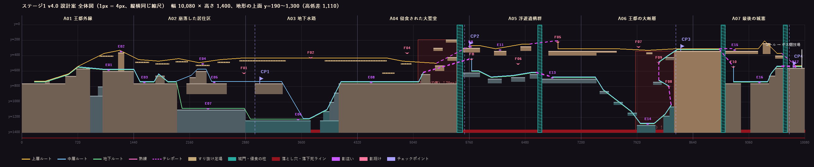
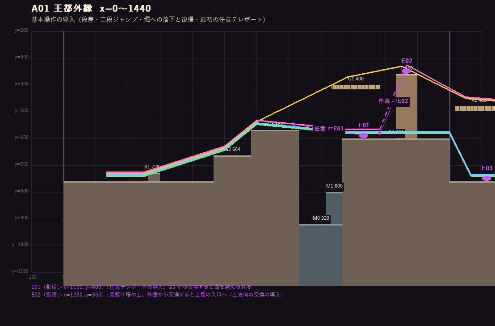
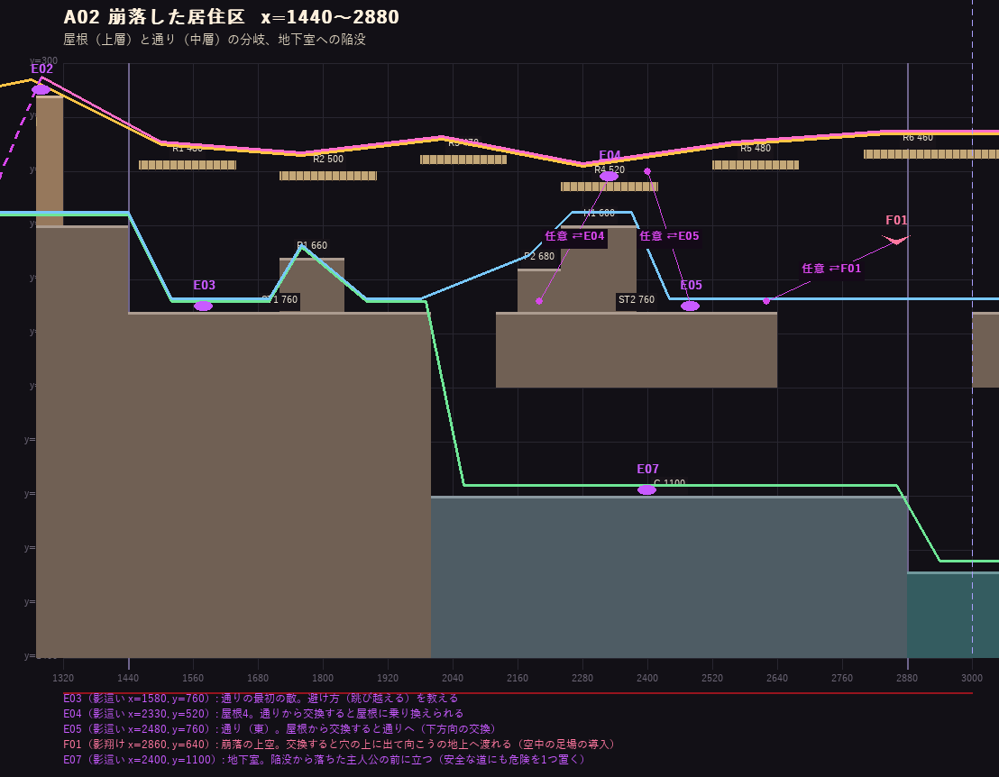
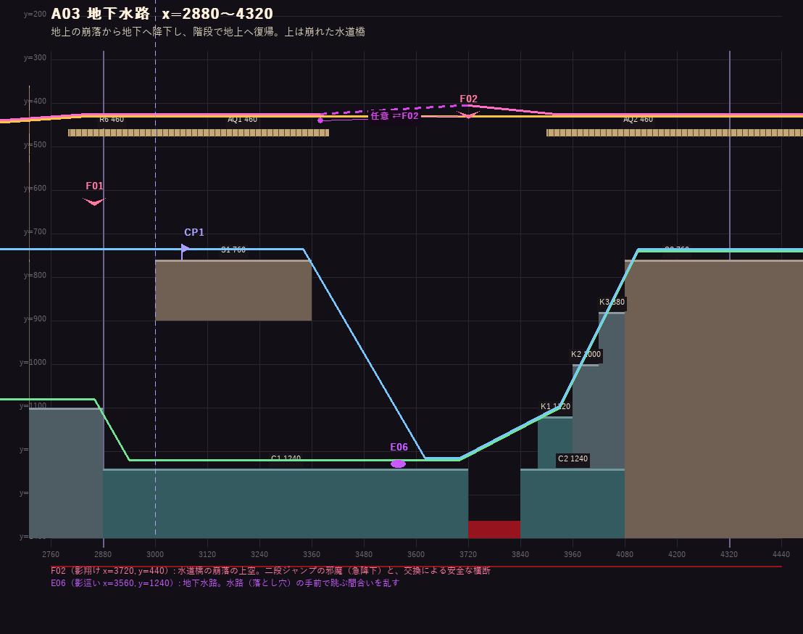
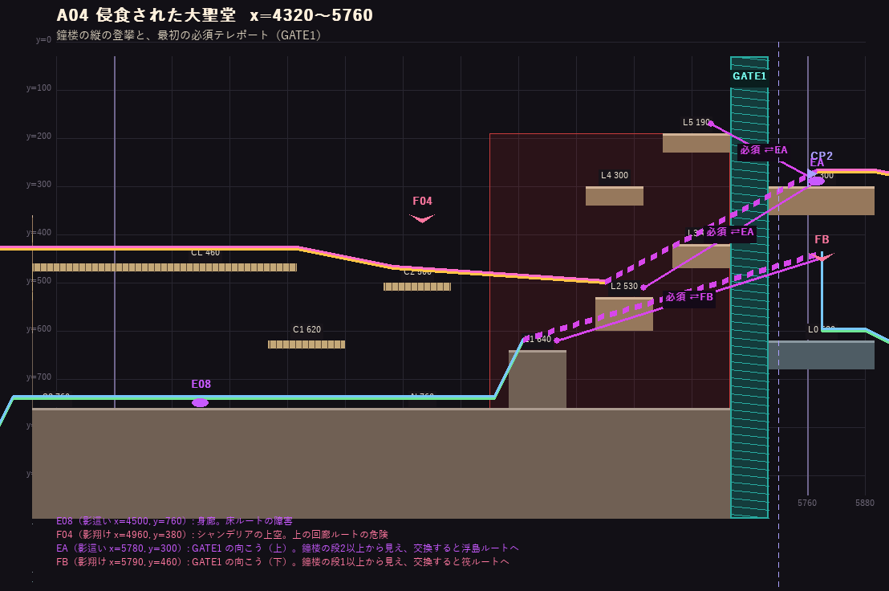
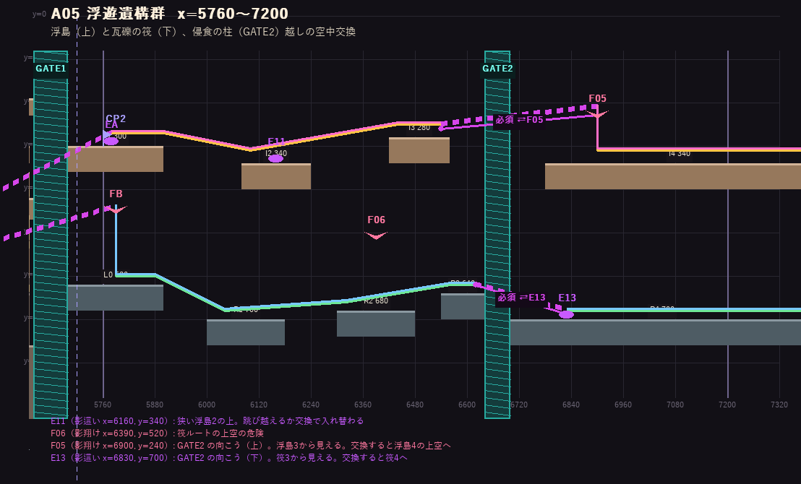
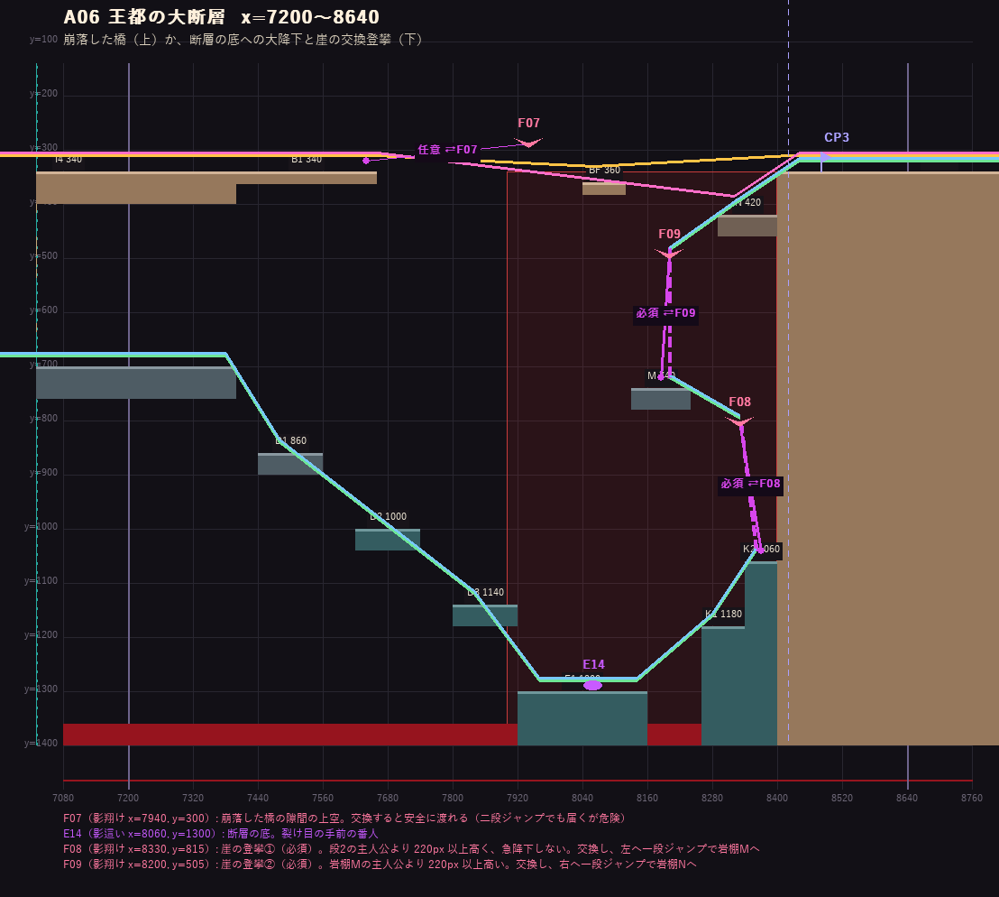
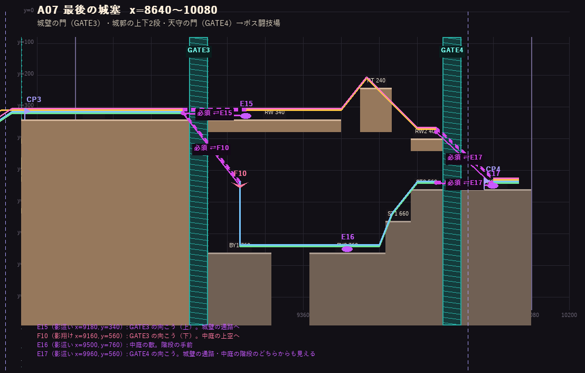

# ステージ1 v4.0 大規模立体マルチルート 設計書（設計レビュー用）

作成: Claude, 2026-11-27 ／ 対象: 指示書「ステージ1 v3.0 大規模再設計指示書」

- **ゲームのコード・正式なステージデータ・背景素材は一切変更していません。** 追加したのはこのフォルダ（`stages/stage1_v4_design/`）の資料と検証用スクリプトだけです。
- 数値はすべて、実際の物理・テレポート・カメラのコードを動かして確かめたもの（§9 の verify）か、実測値から積み上げた見積もり（§5・§6 の estimate）です。見積もりは実装後にボットの実測で置き換えます。

## 0. 前提: 名前を「v4.0」にした理由

指示書の名前は「v3.0」ですが、リポジトリでは **ステージ1 v3.0 がすでに実装済みで、既定のステージになっています**（コミット 5a48b75・fa5351a、`stages/stage_1_v3.json`。幅 3,360px、3層、縦スクロール、影翔け）。今回の大規模版と区別するため、本書では **v4.0** と呼び、正式データは `stages/stage_1_v4.json` として新しく作る前提にしています。

| 版 | ファイル | 状態 |
|---|---|---|
| v2.5 | `stages/stage_1.json` | 動作確認済みの基準（`--stage stage_1.json`） |
| v3.0 | `stages/stage_1_v3.json` | 現在の既定（`config.DEFAULT_STAGE`） |
| v4.0 | `stages/stage_1_v4.json`（承認後に作成） | 本書。設計検証用の下書きは `stage_1_v4_draft.json` |

---

## 1. Phase 1: 既存状態の保存と調査

### 1.1 変更状況と保存方法の提案

- ブランチ `feature/qa-display-visibility`。未コミットの変更は **`README.md`（ルート）だけ**で、提出用テンプレート（氏名・クラス番号を含む）への書き換えです。ゲームのコードとデータに未コミットの変更はありません。
- テスト: **266件すべて成功**（`python -m unittest discover -s tests`、2026-11-27 に実行）。

保存方法の提案（**まだ何も実行していません**）:
1. `README.md` は個人情報を含むので、コミットするかどうかはご本人が判断してください。コミットする場合は、v4.0 の作業とは別のコミットにします。
2. 基準点にタグを付けます: `git tag stage1-v2.5 a90c414`、`git tag stage1-v3.0 fa5351a`。
3. v4.0 の実装は新しいブランチ（例: `feature/stage1-v4`）で行います。v2.5・v3.0 のファイルは変更せず、`stage_1_v4.json` を新しく作ります。

### 1.2 調査結果（現行コード）

| 項目 | 現状 | 根拠 | v4.0 への影響 |
|---|---|---|---|
| カメラの縦追従 | v3.0 で実装済み。`camera_bounds` があるときだけ追従し、縦の基準は「最後に着地した足元」。画面内での足元の位置は上から 0.53（**足元より上に 286px、下に 254px が見える**） | `systems/camera.py:55-77`、`config.py:203-206` | そのまま使える。ただし**上下に約 260px より離れた敵は画面に入らず、交換できない**。この制約に合わせて配置した（§7） |
| ワールド境界 | `camera_bounds` と `kill_y` で縦に広げられる。ローダーは「0〜540 を含む」ことを要求する | `stages/loader.py:114-125` | v4.0 は `top=0, bottom=1400, kill_y=1464` でそのまま読める（下書きで確認） |
| 落下死 | `player.rect.top > kill_y` で死亡。テレポートの安全判定は `bottom > kill_y` と `top < -540` を外とする | `systems/world.py:177`、`systems/teleport.py:83` | 城門を y=−600〜1400 にすれば上下を抜けられない（verify で確認） |
| 敵AI | 画面外（横 ±400、縦 ±100）の敵は更新しない。**影翔けは主人公を追って最大 120px 寄ってくる**ため、待つと交換先が主人公側にずれる | `systems/world.py:86-91`、`config.py:135-161` | 必須の交換は、待ち時間（0.3〜2.4秒）を変えても成立するよう配置した（§9） |
| 追跡壁 | 右向きの縦の帯が1枚で、速さは一定（300px/s）。セグメントの仕組み（`direction`・`top`・`bottom`）はあるが、使っているのは1枚だけ | `systems/chasing_wall.py:20-68` | **一定 300px/s では v4.0 はクリアできない**（§6） |
| チェックポイント | 1か所だけ。有効になる条件は `max_x >= cp.x`（層に依存しない）。リトライの状態は `main.py` の真偽値1つ。目印の床は「cp.x を含む地形のうち最も高い上面」 | `stages/loader.py:54-98`、`main.py:72,113-124,199`、`stages/renderer.py:571` | 複数に対応させる。目印の床の決め方は、層が重なる場所で誤るので直す |
| 背景 | 空だけが縦に 0.2 倍で動き、遠景・中景・近景・地面の影は地形と同じだけ動く。**地平線はワールドの y≈420 に固定** | `stages/background.py:543-580` | 地面の高さが y=190〜1,300 で変わるので、地平線の高さをエリアごとに指定できるようにする（§7.3） |
| 穴・城門・地下の描画 | 穴の検出（`find_pits`）と穴の種類の判定は「地面の下端が 540 以上」を前提にしている。地下の空洞の絵は「上面が 540 より下にある幅 200 以上の床」だけ | `stages/renderer.py:172-209, 547-564` | 一般化が必要（§8） |

ついでに見つけた点: `player/protagonist.py:38` のコメントが文字化けしています（v3.0 で `teleport.py` について修正したのと同じ種類のものです）。

### 1.3 主人公の到達能力（実測。`motion_probe.py`）

| 動作 | 上昇量 | 平地での飛距離 | 段差 +124 に届く距離 | 段差 +240 に届く距離 |
|---|---|---|---|---|
| 一段ジャンプ | 144px | 343px | 248px | — |
| 二段ジャンプ | 288px | 591px | 538px | 464px |
| 二段＋空中ダッシュ | 288px | 731px | 678px | 604px |

落下: 400px で 0.75秒、1,000px で 1.42秒。走る速さは 336px/s、空中ジャンプのない登攀は「一段で +120、約 0.75秒」が基本単位です。設計では余裕を 20px 以上取りました（一段で登る段差は 124px 以下、二段は 268px 以下）。

---

## 2. ステージ全体のマップ（成果物1）

| 値 | v4.0 |
|---|---|
| 通常区間の幅 | 10,080px（ゴール x=10,040 → ボス闘技場の入口） |
| 縦の範囲 | y=0〜1,400（`camera_bounds`）、落下死ライン 1,464 |
| 地形の上面 | y=190（鐘楼の頂上）〜1,300（大断層の底）。**高低差 1,110px** |
| 地形 | 固体 59（城門4を含む）、すり抜け足場 12 |
| 敵 | 25体（影這い 16、影翔け 9）。新しい敵の種類は追加しない |
| 必須テレポート | 上層ルート 4回、中層・地下ルート 6回 |
| チェックポイント | 通常区間に3か所（CP1〜CP3）＋ボス前1か所（CP4） |

層の考え方: **上層**（屋根・水道橋・浮島・橋・城壁の上、y≈190〜520）、**中層**（通り・身廊・中庭、y≈560〜760）、**下層・地下**（堀・地下室・地下水路・筏・断層、y≈620〜1,300）。どの層から落ちても、ほとんどの場所では下の層に着地して進み続けられます。落下死になるのは、赤で示した場所（地下水路の水路、浮遊遺構の下の深淵、断層の裂け目、城郭の堀）だけです。

---

## 3. 各エリアの拡大マップと設計（成果物2）

座標の詳細は [TABLES_v4.md](TABLES_v4.md)（成果物3）にあります。図の線は、黄＝上層ルート、水色＝中層ルート、緑＝地下ルート、桃＝熟練ルート、紫の点線＝テレポートです（太い線は必須）。

### A01 王都外縁（x=0〜1,440）基本操作の導入

- 段差の連続（+32 → +96 → +96）でジャンプを覚え、空堀（幅160）を一段ジャンプで越えます。
- **堀に落ちても死にません**。堀の中の段（+120）を一段、外壁（+200）を二段で登って戻ります。二段ジャンプの導入を兼ねています。
- 最初の任意テレポート: 段の上から E01 と交換すると、堀を越えて外壁へ移れます。外壁から見張り塔の上の E02 と交換すると、上方向の交換を体験し、上層（屋根）ルートの入口に立てます。
- 検証中に直した点: 崩れた足場 U1 を y=440 に置いたところ、堀を越える一段ジャンプが U1 に乗ってしまったため、U1 を y=400（一段の頂点 424 より上）に上げました。

### A02 崩落した居住区（x=1,440〜2,880）屋根と通りの分岐

- **上層**: 屋根 R1〜R6 を一段ジャンプで渡ります（隙間 80〜120）。速いのですが、足場が狭く、隙間から落ちると通りに着地します。
- **中層**: 通り。瓦礫（+100）・倒れた家（+80）の階段状の地形と、影這い E03・E05 がいます。瓦礫 P1・倒れた家 H1 の真上に屋根があり、登れば上層に乗り換えられます。
- **地下**: 陥没（x=2,000〜2,120）に落ちると地下室（y=1,100）に入ります。地下室は崩落の下をくぐって地下水路につながる、安全だが遠回りの道です（E07 が1体います）。
- 崩落（x=2,640〜3,000、幅 360）は、二段ジャンプか、上空の F01 と交換して越えます。落ちても地下水路に着くだけです。
- 屋根から通りの E05 と交換すると、下方向の交換になります。

### A03 地下水路（x=2,880〜4,320）地下への降下と地上への復帰

- 地上（CP1 のある A3S1）の先は崩れていて、中層のプレイヤーは地下水路（y=1,240）へ降ります（落差 480）。
- 地下水路には水路（幅 120）の落とし穴があり、手前に E06 がいます。
- **復帰の階段**（+120 × 4段）で地上（大聖堂の前庭、y=760）に戻ります。
- **上層**: 水道橋（y=460）。崩落（幅 500）は二段ジャンプで届きますが、F02 の急降下が邪魔をします。F02 と交換すれば安全に渡れます。
- 検証中に直した点: 地上の端から走って落ちると、そのまま水路（落とし穴）に落ちていたため、水路を 120px 東へずらしました。

### A04 侵食された大聖堂（x=4,320〜5,760）縦の登攀と最初の必須テレポート

- 鐘楼の中を、段 L1→L2→L3→（左へ）L4→L5 とジグザグに登ります（各 +110〜120）。
- **必須①（GATE1、y=−600〜1,400 の全高）**。向こう側の交換相手は2体で、どちらと交換するかで A05 のルートが決まります。
  - EA（上、y=300）: 鐘楼の段2以上から見えます。交換すると浮島ルート（上層）へ。
  - FB（影翔け、y=460）: 段1以上から見えます。交換すると筏ルート（下層）へ。
  - 身廊の床やシャンデリアからはどちらも見えません（verify で確認）。必ず鐘楼に入る必要があります。
- 上層の回廊（水道橋から続く）を来たプレイヤーは、シャンデリア経由で段2に直接入れます。床から登るより速い道です。F04 がシャンデリアの上空を守っています。
- D案では、鐘楼（Z1）で下から潮がせり上がります（§6）。

### A05 浮遊遺構群（x=5,680〜7,200）浮島と空中テレポート

- **上**: 浮島 I1→I2（E11 が乗っている狭い島）→I3。**下**: 瓦礫の筏 L0→R1→R2→R3。筏の上空には F06 がいます。
- 浮島から落ちると筏に着地します（死にません）。筏から落ちると深淵（落下死）です。
- **必須②（GATE2「侵食の柱」）**。上からは F05（影翔け）しか見えず、交換すると浮島4の上空に出ます（**空中テレポート**）。下からは E13 しか見えず、交換すると筏4に出ます。どちらも、層ごとに交換相手が決まることを verify で確認しました。
- 区間の境界: GATE1 の位置の都合で、実際の始まりは x=5,680 です（仮案の 5,760 から 80px 前倒し）。

### A06 王都の大断層（x=7,200〜8,640）大きな降下と上昇

- **上（崩落した橋）**: 橋の隙間（380px）は、一段ジャンプでは届きません（verify で確認）。二段ジャンプ、F07 との交換、または二段＋空中ダッシュで、吊られた破片 BF か岩棚 N に渡ります。落ちると断層の底へ落ち、下のルートに合流します（死にません）。
- **下（断層）**: 岩棚 D1→D2→D3 を降りて底（y=1,300）へ（落差 600）。裂け目（落とし穴）の手前に E14 がいます。
- **東の崖の交換登攀（必須③④）**: 段1→段2（+120 × 2）までは跳んで登れますが、その先の岩棚 M・N はそれぞれ +320 で、跳んでは届きません（verify で確認）。
  - 段2から F08 と交換し、空中から左へ一段ジャンプで岩棚 M へ。
  - クールダウン（2秒）が明けたら F09 と交換し、右へ一段ジャンプで岩棚 N へ。そこから一段で崖の上（CP3）へ。
  - F08・F09 は、交換する位置の主人公より 220px 以上高い所に置いています。こうすると急降下してこず、待っていても交換先が安定します。最初の案では真下の主人公に急降下してきて、待ち時間によって失敗したり死亡したりしたため、配置を直しました。
- 検証中に直した点: 吊られた破片 BF が F09 の交換の真上にあり、頭がぶつかって岩棚 N に届かなかったため、BF を西へ移しました。

### A07 最後の城塞（x=8,640〜10,080）総合試験とボス戦への接続

- **必須（GATE3 城壁の門）**: 崖の上から E15（城壁の上へ）か F10（中庭の上空へ）と交換します。
- 城壁の上: 通路 → 塔（+100）→ 塔の先の通路。中庭: 堀（落とし穴）を越え、E16 を避け、階段（+100 × 2）を登ります。
- **必須（GATE4 天守の門）**: 城壁の上からも中庭の階段からも E17 が見えます。交換すると天守の前庭（CP4）に出て、x=10,040 でボス闘技場へ移ります。
- ボス闘技場と撃破後の脱出区間は、指示書のとおり範囲外です（入口の座標だけを決めています）。

---

## 4. 敵配置と役割（成果物4）

全25体の座標と役割は [TABLES_v4.md §2](TABLES_v4.md) にあります。役割の分類は次のとおりです。

| 役割 | 敵 | 数 |
|---|---|---|
| 必須テレポートの相手（城門・崖） | EA, FB, F05, E13, F08, F09, E15, F10, E17 | 9 |
| 任意の近道・層の乗り換え（上方向・下方向） | E01, E02, E04, E05, F01, F02, F07 | 7 |
| 跳躍の邪魔（急降下・飛びかかり） | E03, E06, E07, E08, E11, E14, E16, F04, F06 | 9 |

- 必須の交換は、**どれも1か所の立ち位置から「その層の相手が1体だけ見える」** ように置きました。同じ城門で、上と下のどちらの相手を選ぶかが、そのままルートの選択になります。
- 必須の交換の相手は、交換する位置に向かって急降下してこない位置に置きました（F08・F09）。跳躍の邪魔をする敵とは役割を分けています。

---

## 5. 攻略ルートの比較（成果物5）

所要時間は見積もりです（`estimate.py`。実測した跳躍・落下の時間を積み上げたもの）。**ペース**は、標準＝迷わない、2回目＝移動の時間 ×1.15・交換の判断 1.0秒、初見＝移動の時間 ×1.35・判断 1.5秒・各エリアで 1秒見回す、です。いずれも死亡とリトライは含みません。

| ルート | 経路 | テレポート（必須） | クリア 標準／2回目／初見 | 特徴 |
|---|---|---|---|---|
| 上層 | 屋根 → 水道橋 → 鐘楼の段2 → 浮島 → 橋 → 城壁の上 | 4（4） | 36.6／46.4／58.5秒 | 最速。狭い足場と二段ジャンプが多い。落ちると下の層へ |
| 中層 | 通り → 崩落を二段で → 地下水路 → 階段 → 鐘楼の段1 → 筏 → 断層の底 → 崖の交換登攀 → 中庭 | 6（6） | 46.0／57.4／72.1秒 | 標準。上下の移動量が最も大きい |
| 地下 | 陥没 → 地下室 → 地下水路 → 以降は中層と同じ | 6（6） | 44.6／55.8／70.2秒 | 二段ジャンプの要求が少なく安全。中層より少し速い（崩落を越えない分） |
| 熟練 | 上層＋任意の交換（E02・F02）＋橋を二段＋空中ダッシュで岩棚 N へ | 6（4） | 35.8／46.2／58.8秒 | 交換の読みと空中ダッシュ |

所見:
- 地下ルートが中層ルートより速くなっています。「安全だが遠回り」にするなら、地下室の床に段差を足すか、E07 を増やす調整が必要です（§10-6）。
- 指示書の目標「初見で2〜4分」に対し、初見のペースで死亡なしの見積もりは **約1分〜1分12秒** です。死亡とリトライ（CP から）を含めれば2〜4分に入る見込みですが、「死亡なしで2〜4分」の意味なら、ステージを大きくするか、移動を遅くする必要があります（§10-1）。

---

## 6. 追跡壁の仕様比較（成果物6）

### 6.1 比較した方式

| 方式 | 内容 |
|---|---|
| A | 現行どおり、常に右へ 300px/s |
| B | 縦の区間（大聖堂の鐘楼 Z1、大断層の東の崖 Z2）では、横の壁が止まり、下から「侵食の潮」がせり上がる。速さは 300px/s のまま |
| C | エリアごとに速さを変える（壁の先端がいるエリアの速さ） |
| D | B と C の併用 |
| D+ | D ＋ 距離の上限（壁との距離が 1,100px を超えた分 × 1px/s だけ速くなる。上限 600px/s） |

C・D の速さは、「中層・地下のうち遅い方」の「2回目」ペース（A01・A02 だけは初見ペース）でエリアを通過する平均の速さ × 0.92 です: **A01 181 ／ A02 124 ／ A03 162 ／ A04 237 ／ A05 173 ／ A06 107 ／ A07 147（px/s）**。潮の速さは Z1 が 70px/s（y=820→190）、Z2 が 95px/s（y=1,400→340）です。潮は**主人公が区間の中にいる間だけ**せり上がり、主人公が区間を出たら、横の壁は区間の入口から再び進みます（止まっていた時間を、先行の余裕として与えないため）。

### 6.2 結果（`estimate.py`。壁は開始位置 x=−600。最小距離は壁の先端と主人公の左端の差）

| 方式 | 標準 | 2回目 | 初見 | 標準のときの最大距離 | 判定 |
|---|---|---|---|---|---|
| A | **全ルートで死亡**（9〜15秒、A02〜A03） | 死亡 | 死亡（5〜6秒、A01） | — | × |
| B | A と同じ（縦の区間に着く前に死亡） | 死亡 | 死亡 | — | × |
| C | 生存（最小 744px） | 生存（最小 677px） | **中層は鐘楼で死亡**（35秒）、**地下は GATE3 で死亡**（62秒）。上層は最小 326px | 3,700〜5,000px | △ |
| D | 生存（最小 744px） | 生存（最小 677px） | **全ルート生存**（最小: 中層 42px（GATE2）、地下 187〜260px、上層 326px） | 3,700〜5,000px | ○ |
| **D+** | 生存（最小 656px） | 生存（最小 569px） | 全ルート生存（D と同じ） | **1,500〜1,600px** | **◎（推奨）** |

必須の交換の地点で、その場で立ち止まって考えられる秒数（D+）:

| ルート | 標準 | 初見 |
|---|---|---|
| 上層 | EA 4.2 / F05 3.8 / E15 4.2 / E17 6.8 | EA 5.4 / F05 3.6 / E15 7.0 / E17 7.4 |
| 中層 | FB 6.4 / E13 4.5 / F08 10.2 / F09 7.2 / F10 9.9 / E17 8.3 | FB 2.4 / E13 1.7 / F08 4.8 / F09 4.8 / F10 6.4 / E17 3.2 |

### 6.3 推奨: D+（D＋距離の上限）

1. **A・B では成り立ちません。** 10,080px を 300px/s の壁が進むのは 35.6秒です。一方、縦の移動がある分、主人公が横に進む平均の速さは、標準でも 220〜280px/s しかありません。
2. **C では、縦の区間が不公平になります。** 横から来る壁は鐘楼の全部の階を同時に飲み込むので、9割登った人も、1段目にいる人も同じ瞬間に死にます。登った高さが報われません。実際に、中層・初見のペースでは鐘楼の段1で死亡しました。D では、その区間で潮が下から迫るので、登るほど安全になり、同じペースでも生き残ります。
3. **距離の上限（+）で、上手な人の緊張感を保ちます。** C・D は初見・2回目のペースに合わせているため、標準のペースだと壁が 5,000px も後ろになり、画面に現れません。距離の上限を付けると、最大距離が約 1,500px に収まります。初見のプレイヤーは 1,100px より離れることがないので、影響を受けません。
4. 実装は「壁の速さを、壁の先端のエリアと主人公との距離で決める」「縦の区間で潮のセグメントを1枚足す」の2点で、既存のセグメントの仕組みの延長でできます（§8）。

注意点: 中層・初見の最小距離 42px（A05 の GATE2 の前）と 58px（A04）は余裕が少なすぎます。実装後のボットの実測で、A04・A05 の速さを1割ほど下げる前提です（§10-7）。

### 6.4 チェックポイントからの再開位置と壁の距離（wall_gap）

各 CP から再開し、初見のペースで、どのルートでも次の CP（最後はゴール）まで壁との距離 300px 以上を保てる最小値を求めました（D）。

| CP | 位置 | 計算上の最小 | 推奨値 |
|---|---|---|---|
| CP1 | x=3,000（A03 の入口） | 800 | 800 |
| CP2 | x=5,700（GATE1 の向こう） | 1,000 | 1,000 |
| CP3 | x=8,420（東の崖の上） | 550 | 700 |
| CP4 | x=9,880（ボス前） | 300 | 600（ボス戦では壁が止まるため、入口までの距離だけ） |

D+ では、1,100px より大きい値を指定しても、距離の上限によってすぐに 1,100px まで詰まります。D+ での値は、実装後にボットで決め直します。

---

## 7. カメラ設計（成果物7）

### 7.1 方針
現行の v3.0 の縦追従（着地した足元を基準にし、画面の上から 0.53 の位置に置く。空中で画面の上 96px・下 140px を出たら即座に寄せる）を**そのまま使います**。v4.0 の配置は、すべてこの規則のもとで、交換相手が見える・見えないを verify で確かめています（18か所の交換は、実際のカメラとクリックの経路で成立しました。見えてはいけない組み合わせは8件です）。

### 7.2 追加する機能（必要最小限）
| 機能 | 内容 | 理由 |
|---|---|---|
| 落下の先読み | 下向きの速度が 500px/s を超えたら、縦の目標を最大 120px 下へずらす | 断層への 600px の降下や、地下水路への落下で、着地点が画面の下端ぎりぎりになるため |
| 区間ごとの縦の位置（`camera_zones`） | x の範囲ごとに `follow_y_ratio` を上書きする。例: 鐘楼・東の崖では 0.62（上が 335px 見える） | 縦の区間で、上の足場が見えないまま跳ぶのを防ぐ。**ただし変えると、交換相手が見える範囲も変わる**ので、verify をやり直して「見えてはいけない」を守る |
| テレポート後の縦の演出 | `teleport_camera_cue` に縦の移動量を加える | 現行の流線は横の移動量だけで出している（`systems/world.py:207`）。上下の交換で流線が出ない |

照準: ワールド座標と画面座標の変換は `Camera.to_world / to_screen` の1か所にまとまっていて、縦にも対応済みです。verify では、画面に体の一部だけが見えている敵も、実際のクリックの経路（`find_target`）で選べることを確認しました。待ち時間 2.4秒のとき、FB の体の中心が画面の外に出る瞬間がありましたが、見えている部分をクリックすれば交換できます。

### 7.3 背景
- **地平線の高さをエリアごとに指定します**（`background.horizon: [[x, y], ...]`）。遠景・中景・近景・地面の影は、カメラの位置での地平線の高さに合わせてずらします。現行は y≈420 に固定です。
- **地下の背景は手続き描画**にします。現行の `_bake_cave` を「地下の範囲（JSON で指定）」に広げ、地下水路の水面の反射や、侵食の青緑の脈を描きます。
- 深淵（A05）と断層（A06）は、下に地面がないので、近景（地面の瓦礫）を描かず、霧と遠くの浮遊遺構のシルエットにします。
- **正式な背景素材（`draft_v1` など）は上書きしません。**

新規素材の候補（どれも必須ではありません。最初は手続き描画で代用します）:

| # | 素材 | 使う場所 |
|---|---|---|
| 1 | 地下水路の奥の壁（アーチ・水路）の繰り返し画像 | A02 地下室、A03 |
| 2 | 大聖堂の内部（柱・ステンドグラスの残骸）の遠景 | A04 |
| 3 | 深淵の霧と、遠くの浮遊遺構のシルエット | A05 |
| 4 | 断層の岩壁（縦に繰り返せるもの） | A06 |
| 5 | 城塞の遠景（城壁・天守） | A07 |
| 6 | 侵食の潮（縦の追跡壁）の模様 | A04・A06（D案） |
| 7 | 屋根・水道橋・橋の足場の見た目（すり抜け足場の別の絵） | A02・A03・A06 |

---

## 8. 必要なコード変更一覧（成果物8）

方針: v3.0 と同じく、**新しい項目がステージ JSON にあるときだけ働く追加**にします。v2.5・v3.0 の動きと描画は、1px・1フレームも変えません。

| # | ファイル | 変更 | 既存への影響 |
|---|---|---|---|
| 1 | `systems/chasing_wall.py` | エリアごとの速さ（`wall.area_speeds`）、距離の上限（`wall.catchup`）、縦の区間（`wall.vzones`、上向きのセグメントと潮の状態）。`update(dt)` → `update(dt, player_rect)`。潮の描画 | 項目がなければ従来どおり |
| 2 | `systems/world.py` | 壁の更新に主人公の位置を渡す。`wall_distance` を「横の壁」と「潮」のうち近い方にする。`passed_checkpoint` を「最後に越えた CP」にする | 同上 |
| 3 | `main.py:72,113-124,199` | `checkpoint_ready`（真偽値）を「有効になった CP の番号」にする | CP が1つなら同じ動き |
| 4 | `stages/loader.py` | `checkpoints`（配列）、`wall.area_speeds`・`wall.catchup`・`wall.vzones`、`camera_zones`、`background.horizon`、`areas` の読み込みと検証。従来の `checkpoint` も読める | なし |
| 5 | `stages/renderer.py:172-209` | 穴の検出を「固体のない列が kill_y まで続く範囲」に一般化する（現行は地面の下端が 540 以上の前提）。穴の種類の判定、城門の床の高さ（`_gate_floor_y`）も同様 | v2.5・v3.0 で同じ結果になることをテストで固定する |
| 6 | `stages/renderer.py:558-575` | 地下の空洞の範囲を JSON で指定できるようにする。CP の目印を複数にし、床の決め方を「再開位置の足元のすぐ下の上面」にする | 同上 |
| 7 | `stages/renderer.py`（焼き込み） | 大きな固体（最大 600×1,060px）を、上面の帯だけ焼き込み、内部は塗りつぶしにする | メモリ・初期化時間の対策。v2.5 は従来どおり |
| 8 | `stages/background.py:543-580` | 地平線の高さ（`horizon`）、地下・深淵の手続き描画 | `horizon` がなければ従来どおり |
| 9 | `systems/camera.py` | 落下の先読み、`camera_zones` | 縦の範囲がなければ y=0 のまま |
| 10 | `systems/effects.py`・`systems/world.py:207` | テレポートの流線に縦の移動量を加える | 縦の移動量が 0 なら同じ |
| 11 | `ui/hud.py:71-84` | 「追跡壁まで」の表示を、潮のときは縦の距離にする。エリア名の表示（任意） | なし |
| 12 | `tests/stage1_bot.py:112-114` | `find_pits` の呼び方を一般化後のものに合わせる。v4.0 用のルート表（`estimate.py` の `ROUTES` が下敷き） | 既定値は従来どおり |
| 13 | `stages/stage_1_v4.json` | 新規（`stage_1_v4_draft.json` ＋ `v4_proposal` の内容を正式な項目にしたもの） | — |
| 14 | `config.py` | 新しい既定値（先読みの量など）。`DEFAULT_STAGE` は承認後に切り替える | なし |

変更しないもの: 物理（`player/`・`collision.py`）、テレポート（`teleport.py`・`targeting.py`）、敵の AI（`enemies/`）。v4.0 の配置は、現行の仕様のまま成立することを verify で確かめています。

---

## 9. テスト計画（成果物9）

### 9.1 今回すでに行った検証（`verify.py`。結果は `verify_result.json`、**不合格 0件**）
- 跳躍 71本（届くはずの63本、届かないはずの8本）を、実際の物理で実際の操作（右を押す・ジャンプ・二段目・空中ダッシュ）をして確認。
- テレポート 18か所（必須 11、任意 7）を、実際のカメラ・クリックの経路で確認。必須の交換は、待ち時間 0.3／0.9／1.5／2.4秒の4回とも成立。任意の交換は、すぐに交換した場合（0.3／0.9秒）に成立。
- 見えてはいけない組み合わせ 8件（登らずに城門の相手が見えない、上の層から下の層の相手が見えない、など）。
- 敵25体の足場（影這いが足場の上にいる、影翔けが地形に埋まっていない）。

任意の交換で分かったこと: 影翔けは待つと主人公に寄ってくるので、F01 と2.4秒待ってから交換すると、崩落を渡れずに地下に落ちます（死にはしません）。「すぐ交換する」のが正解になる配置で、仕様として妥当と判断しました。

### 9.2 実装後のテスト
| # | 内容 | 合格の基準 |
|---|---|---|
| T-01 | v2.5・v3.0 の回帰: 全テスト、物理トレース `physics_trace_v22.json`、描画の画素一致 | 266件以上がすべて成功、差分なし |
| T-02 | `verify.py` の内容を unittest にする（跳躍・交換・見えない・足場） | 全件成功 |
| T-03 | v4.0 のボットで4ルート × ペース2種 × 踏み切り ±20px × 100通り | 各ルートで 100/100 クリア |
| T-04 | テレポートなしでは GATE1〜4・東の崖を越えられない（ボット＋ランダム入力＋幾何） | 抜け道なし |
| T-05 | 各層の隙間で、わざと落ちる操作 | 落下死の場所以外では、どこで落ちてもクリアできる。遅れの最大値を記録する |
| T-06 | 照準と画面外の判定（縦）。交換の直後に主人公が画面内にいること | 選べるのは見えている敵だけ。交換直後に主人公が画面の上下 48px 以内にいる |
| T-07 | 追跡壁の公平さを実測し、§6 の見積もりを置き換える | 初見のペースで、全ルートの最小距離が 300px 以上。必須の交換で考えられる時間が 2秒以上 |
| T-08 | 複数の CP: ルートごとに CP1〜CP4 が有効になり、再開位置と wall_gap が正しい | どのルートでも、通過した最後の CP から再開できる |
| T-09 | 潮: 区間に入ると始まる、出ると止まる、区間の外の人には効かない、区間が飲み込まれる | 仕様どおり |
| T-10 | 描画: 各エリア・分岐・城門・潮のスクリーンショット。10,080px のステージでのフレーム時間と、焼き込みのメモリ | 16.7ms を超えるフレームが v3.0 と同程度 |

---

## 10. 未解決事項（成果物10）

1. **クリア時間の目標**: 初見で死亡なしの見積もりは約1分〜1分12秒です。「2〜4分」がリトライを含む時間なら、このままで近づきます。含まない意味なら、ステージを伸ばすか移動を遅くする必要があります。
2. **名前**: 「v3.0」はすでに使われているので、本書では v4.0 としました。この呼び方でよいか、確認をお願いします。
3. **壁の速さをどのペースに合わせるか**: 本書では「2回目」（導入部は初見）にしました。より厳しく（標準）すると、初見のプレイヤーは死亡とリトライが増えます。
4. **距離の上限（D+）の採用**: 「壁は一定の速さで迫る」という、これまでの方針を変えることになります。
5. **潮の見た目と HUD**: 横の壁と同じ色・質感でよいか、表示を「下まで」にするか。
6. **地下ルートが中層ルートより速い**: 「安全だが遠回り」にするなら、地下室に段差を足すか、敵を増やします。
7. **初見の余裕が小さい場所**（中層ルートの GATE1・GATE2 の前、42〜58px）: A04・A05 の壁の速さを下げる前提です。
8. **区間の境界の調整**: A05 は x=5,680 から始まる（GATE1 の位置）。ほかのエリアは仮案どおりです。
9. **高低差**: 1,110px で、目標（900〜1,100px）を 10px 上回っています。鐘楼の頂上を 10px 下げれば目標内に入ります。
10. **ボス闘技場と撃破後の脱出区間**: 範囲外です。CP4 の先、x=10,040 が入口です。
11. **任意の交換で、影翔けが寄ってくる問題**: 待つと交換先が主人公側にずれます（F01・F02・F07）。仕様のままでよいか。
12. **カメラの区間ごとの調整**: 入れると、交換相手が見える範囲が変わります。入れる場合は、本書の配置を verify でやり直します。

---

## 付録: このフォルダのファイル

| ファイル | 内容 |
|---|---|
| `DESIGN_v4.md` | 本書 |
| `TABLES_v4.md` | 座標付きの地形・敵・CP の表（`make_tables.py` で生成） |
| `maps/00_overview.png`、`maps/01_A01.png`〜`07_A07.png` | 全体図・エリアごとの拡大図（`render_maps.py` で生成） |
| `v4data.py` | 設計の座標データ（唯一の元データ） |
| `stage_1_v4_draft.json` | 現行のローダーで読める下書き（`build_draft.py` で生成。正式データではない） |
| `motion_probe.py` / `.json` | 跳躍・落下の実測 |
| `verify.py` / `verify_result.json` | 実際の物理・テレポート・カメラによる検証 |
| `estimate.py` / `estimate_result.json` | ルートの所要時間と追跡壁の方式の比較 |

再生成の手順（`game` フォルダで）: `python stages/stage1_v4_design/build_draft.py` → `verify.py` → `estimate.py` → `render_maps.py` → `make_tables.py`
